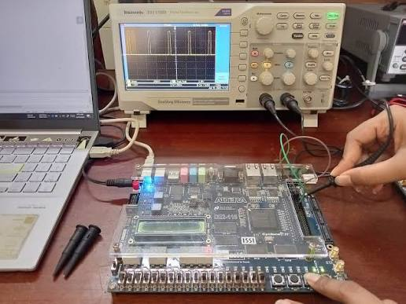
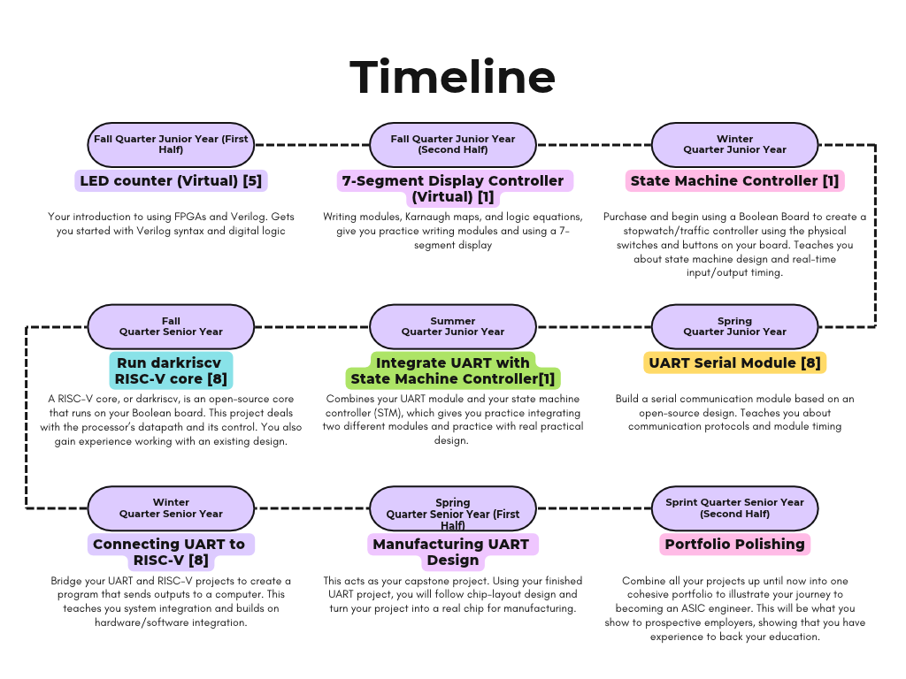

# Graduating Ready to Be an ASIC Engineer

*© Calvin Evans, Ampheo blog ("How to Become and FPGA Engineer")*

**Prepared for:** Husky student pursuing a job as an ASIC engineer\
**Prepared by:** Nathan Strach\
**Date:** November 22, 2026

---

## Table of Contents
- [Purpose](#purpose)
- [Choosing ASIC-Focused Courses](#choosing-asic-focused-courses)
  - [Selecting Digital Design Electives](#selecting-digital-design-ee-electives)
  - [Expanding Technical Skills](#expanding-technical-skills)
- [Building Hardware Design Projects](#building-hardware-design-projects)
  - [Gaining Experience Using a Simulated FPGA](#gaining-experience-using-a-simulated-fpga)
  - [Bringing Projects to Life](#bringing-projects-to-life)
- [References](#references)
## Purpose
Companies hiring entry-level application-specific integrated circuit (ASIC) engineers expect new graduates to arrive with digital design skills they can use on day one. These skills include a hardware description language, knowledge of computer architecture, and hands-on lab experience[^1]. At UW Bothell, your uppper-division electives build that foundation, and projects on field-programmable gate arrays (FPGAs), which act as programmable versions of an ASIC, let you apply it outside of class. This plan covers which courses to take and which hardware projects to tackle so you graduate with the experience those employers seek.

## Choosing ASIC-Focused Courses
As an electrical engineering major at UW Bothell, you are required to take three electives from the 400 range of electrical engineering courses.
The following sections cover address the three best choices for electives, along with courses outside your major that fill the remaining gaps. 

### Selecting Digital Design EE Electives
Entry-level positions for ASIC engineers seek candidates with specific skills. Annapurna Labs, one of Amazon’s labs that designs custom chips, requires proficiency in a hardware description language, or HDL, such as Verilog or SystemVerilog [^1]. An ideal candidate has a degree focusing on very large-scale integration or VLSI, more commonly referred to as digital design [^1]. Few courses at UW Bothell teach digital design, they are as follows: B EE 427, which teaches Verilog and register transfer level (RTL) design; B EE 440, which teaches design for testing through Verilog labs; and B EE 486, which teaches the fabrication of integrated circuits or ICs [^3]. B EE 475, Introduction to VLSI System Design, teaches the most ASIC-specific skills of any UW Bothell course but does not appear on the approved elective list[^2]

Make B EE 427, 440, and 486 your three elective choices and take B EE 475 as an additional course in your senior year.

### Expanding Technical Skills
The same listing asks for knowledge of computer architecture and scripting experience, along with research or lab experience in chip design[^1]. No approved EE elective teaches these skills[^2], but the Computing and Software Systems (CSS) program offers CSS 342, which teaches data structues and algorithms, and CSS 422, which teaches computer artchitecture and organization[^4].

Take CSS 342 and then CSS 422 early on in your junior year to build your understanding of computer architecture. 

## Building Hardware Design Projects
This section covers two stages of hands-on FPGA practice including projects on a simulated board then projects on a physical board. The following figure 
shows projects you can begin with using FPGA Virtual Lab and then using a physical FPGA board and how they progress in complexity. 

**Figure 1: Timeline of FPGA Projects, Each Building the Skills for the Next**

*Source: project ideas from [^5], [^7], and [^8].*
   
### Gaining Experience Using a Simulated FPGA
An FPGA uses a reprogrammable chip that acts as custom digital hardware, which makes it a practical platform for testing chip designs. The Open Source FPGA Foundation offers a free course that is accessible
in your browser and teaches Verilog through a seven-segment display project on a virtual board[^5]. A physical FPGA is not needed to learn on this simulator so there is no need to spend money on an FPGA.

Complete the Open Source FPGA course during the fall quarter of your junior year, then make the project your own by adding a feature such as a counter reset button.

### Bringing Projects to Life
A simulator cannot reproduce real-world debugging. A physical board adds real inputs, outputs, and timing, and employers expect graduates to join the workforce with that practical experience [^6]. As one University of Illinois 
professors said about his hands-on chip design course, "Companies don't want students learning this on the job." [^6] The AMD RealDigital Boolean Board costs $87 and works with AMD's Vivado design software, which makes 
physical practice affordable for students [^7].

Buy a Boolean Board after finishing the virtual course, and complete one physical project per quarter, following the sequence in Figure 1. Document each project as you go: keep your code on GitHub, record photos 
and videos, and write a README that explains your design decisions. Combine these records into a portfolio to show employers.

## References

[1] Annapurna Labs (U.S.) Inc., "ASIC Engineer I, Annapurna Labs, Early Career - 2027," *Indeed.com*, 20 September 2026. [Online]. Available: https://www.indeed.com/viewjob?jk=b780b4650872ad62. [Accessed Oct. 15, 2026].

[2] University of Washington, "Bachelor of Science in Electrical Engineering," *UW General Catalog*, n.d. [Online]. Available: https://www.washington.edu/students/gencat/program/B/EngineeringandMathematics-1092.html. [Accessed Oct. 27, 2026].

[3] University of Washington Bothell, "Electrical Engineering (B EE) Course Descriptions," *UW Course Catalog*, n.d. [Online]. Available: https://www.washington.edu/students/crscatb/bee.html. [Accessed Oct. 27, 2026].

[4] University of Washington Bothell, "Computing and Software Systems (CSS) Course Descriptions," *UW Course Catalog*, n.d. [Online]. Available: https://www.washington.edu/students/crscatb/css.html. [Accessed Oct. 23, 2026].

[5] Open Source FPGA Foundation, "Getting Started with FPGAs," *GitHub*, n.d. [Online]. Available: https://github.com/os-fpga/GettingStartedWithFPGAs. [Accessed Oct. 27, 2026].

[6] P. Patel, "U.S. Universities Are Building a New Semiconductor Workforce," *IEEE Spectrum*, 13 May 2023. [Online]. Available: https://spectrum.ieee.org/chips-act-workforce-development. [Accessed Oct. 27, 2026].

[7] AMD, "RealDigital Boolean Board," *AMD University Program*, n.d. [Online]. Available: https://www.amd.com/en/corporate/university-program/aup-boards/realdigital-boolean-board.html. [Accessed Oct. 27, 2026].

[8] A. Abdelazeem, "ASIC Design Roadmap," *GitHub*, n.d. [Online]. Available: https://github.com/abdelazeem201/ASIC-Design-Roadmap/blob/main/README.md. [Accessed Oct. 30, 2026].

[^1]: Annapurna Labs (U.S.) Inc., "ASIC Engineer I, Annapurna Labs, Early Career - 2027."
[^2]: University of Washington, "Bachelor of Science in Electrical Engineering."
[^3]: University of Washington Bothell, "Electrical Engineering (B EE) Course Descriptions."
[^4]: University of Washington Bothell, "Computing and Software Systems (CSS) Course Descriptions."
[^5]: Open Source FPGA Foundation, "Getting Started with FPGAs."
[^6]: P. Patel, "U.S. Universities Are Building a New Semiconductor Workforce."
[^7]: AMD, "RealDigital Boolean Board."
[^8]: A. Abdelazeem, "ASIC Design Roadmap."
