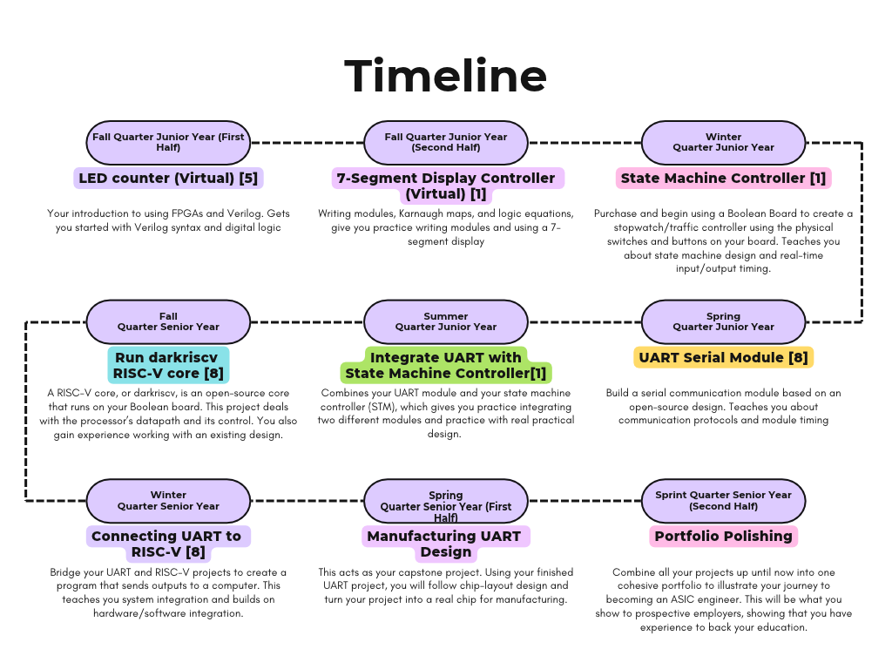

# Graduating Ready to Be an ASIC Engineer
## Table of Contents
- [Purpose](#purpose)
- [Choosing ASIC-Focused Courses](#choosing-asic-focused-courses)
  - [Digital Design EE Electives](#digital-design-ee-electives)
  - [Expanding Technical Skills](#expanding-technical-skills)
- [Hardware Design Projects](#hardware-design-projects)
  - [Experience Using a Simulated FPGA](#experience-using-a-simulated-fpga)
  - [Bringing Projects to Life](#bringing-projects-to-life)
- [References](#references)
## Purpose
Application-specific integrated circuit (ASIC) engineers design the custom chips inside vehicle systems, networking hardware, and consumer electronics. To land an entry-level ASIC role, 
you need to graduate with proven digital design skills. At UW Bothell, your upper-division electives build that foundation, and projects on field-programmable gate arrays (FPGAs),
which act as programmable versions of an ASIC, let you apply it projects outside of class. This plan covers which courses to take and which hardware projects to tackle so you graduate with 
the experience that companies hiring ASIC engineers seek.

## Choosing ASIC-Focused Courses
As an electrical engineering major at UW Bothell, you are required to take three electives from the 400 range of electrical engineering courses.
The following sections will address the three best choices for electives, along with courses outside of the major requirements to be taken. 

### Digital Design EE Electives
Entry-level positions for ASIC engineers seek candidates with specific skills. Annapurna Labs, one of Amazon’s labs that designs custom chips, requires proficiency in a hardware description language, 
or HDL, such as Verilog, SystemVerilog, or VHDL [1]. An ideal candidate has a degree that focuses on very large-scale integration or VLSI, which is more commonly referred to as digital design [1]. 
Few courses at UW Bothell teach digital design, and they are as follows: B EE 427, which teaches Verilog and what is known as register transfer level or RTL design; B EE 440, which teaches design for 
testing through Verilog labs; and B EE 486, which teaches the fabrication of integrated circuits or ICs [3]. Although not part of the elective choices, it should be noted that UW Bothell does offer B EE 475, 
Introduction to VLSI System Design, which teaches the exact skills required of an ASIC engineer.

Make B EE 427, 440, and 486 your elective choices. If you are able, consult your counselor and swap B EE 486 with B EE 475 to best suit your skill development. 

### Expanding Technical Skills
According to Annapurna Labs ASIC engineer job listing, in the same breath as digital design proficiency, they seek candidates with knowledge of computer architecture and scripting experience [1]. 
Ideal candidates will also have research or lab experience in chip design [1]. While there aren’t any EE electives that teach these skills [2], the CSS (Computing and Software Systems) program at 
UW Bothell offers two courses, CSS 342, which teaches data structures and algorithms, and CSS 422, which teaches computer architecture and organization. 

Take CSS 342 and then CSS 422 early on in your junior year to get ahead on your understanding of digital design. 

## Hardware Design Projects
The following two sections will detail how you will get hands-on experience with skills related to ASIC engineering through means of FPGA projects, digital and then physical. The following figure 
shows projects you can begin with using FPGA Virtual Lab and then using a physical FPGA board and how they progress in complexity. 

### Experience Using a Simulated FPGA
An FPGA uses a reprogrammable chip that acts as custom digital hardware, which makes it a practical platform for testing chip designs. The Open Source FPGA Foundation offers a free course that is accessible
in your browser and teaches Verilog through a seven-segment display project on a virtual board.5 A physical FPGA is not needed to learn on this simulator so there is no need to spend money on an FPGA.

Complete the Open Source FPGA course during the fall quarter of your junior year, then make the project your own by adding a feature such as a counter reset button.

### Bringing Projects to Life
A simulator cannot reproduce real-world debugging. A physical board adds real inputs, outputs, and timing, and employers expect graduates to join the workforce with that practical experience. As one University of Illinois 
professors said of his hands-on chip design course, "Companies don't want students learning this on the job."9 The AMD RealDigital Boolean Board costs $87 and works with AMD's Vivado design software, which makes 
physical practice affordable for students.6

Buy a Boolean Board after finishing the virtual course, and complete one physical project per quarter, following the sequence in Figure 1. Document each project as you go: keep your code on GitHub, record photos 
and videos, and write a README that explains your design decisions. Combine these records into a portfolio to show employers.

**Figure 1: Each FPGA Project Builds the Skills for the Next**

*Source: project ideas from [5], [7], and [8].*
   
## References
[1] Annapurna Labs (U.S.) Inc., "ASIC Engineer I, Annapurna Labs, Early Career - 2027," Indeed.com, 20 September 2026. [Online]. Available: https://www.indeed.com/viewjob?jk=b780b4650872ad62. [Accessed Oct. 15, 2026].
[2] University of Washington, "Bachelor of Science in Electrical Engineering," UW General Catalog, n.d. [Online]. Available: https://www.washington.edu/students/gencat/program/B/EngineeringandMathematics-1092.html. [Accessed Oct. 27, 2026].
[3] University of Washington Bothell, "Electrical Engineering (B EE) Course Descriptions," UW Course Catalog, n.d. [Online]. Available: https://www.washington.edu/students/crscatb/bee.html. [Accessed Oct. 27, 2026].
[4] University of Washington Bothell, "Computing and Software Systems (CSS) Course Descriptions," UW Course Catalog, n.d. [Online]. Available: https://www.washington.edu/students/crscatb/css.html. [Accessed Oct. 23, 2026].
[5] Open Source FPGA Foundation, "Getting Started with FPGAs," GitHub, n.d. [Online]. Available: https://github.com/os-fpga/GettingStartedWithFPGAs. [Accessed Oct. 27, 2026].
[6] P. Patel, "U.S. Universities Are Building a New Semiconductor Workforce," IEEE Spectrum, 13 May 2023. [Online]. Available: https://spectrum.ieee.org/chips-act-workforce-development. [Accessed Oct. 27, 2026].
[7] AMD, "RealDigital Boolean Board," AMD University Program, n.d. [Online]. Available: https://www.amd.com/en/corporate/university-program/aup-boards/realdigital-boolean-board.html. [Accessed Oct. 27, 2026].
